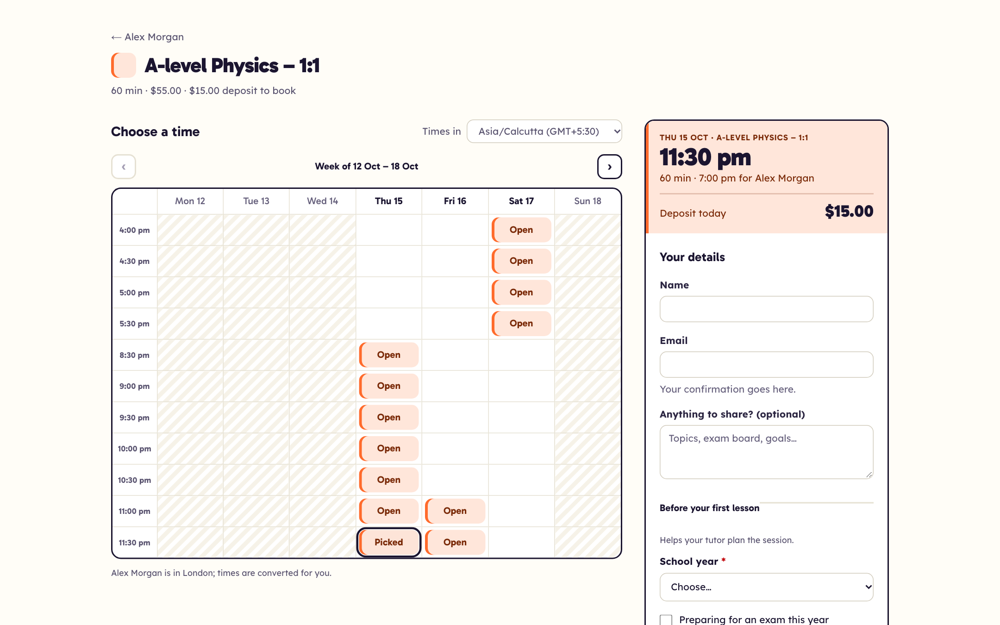
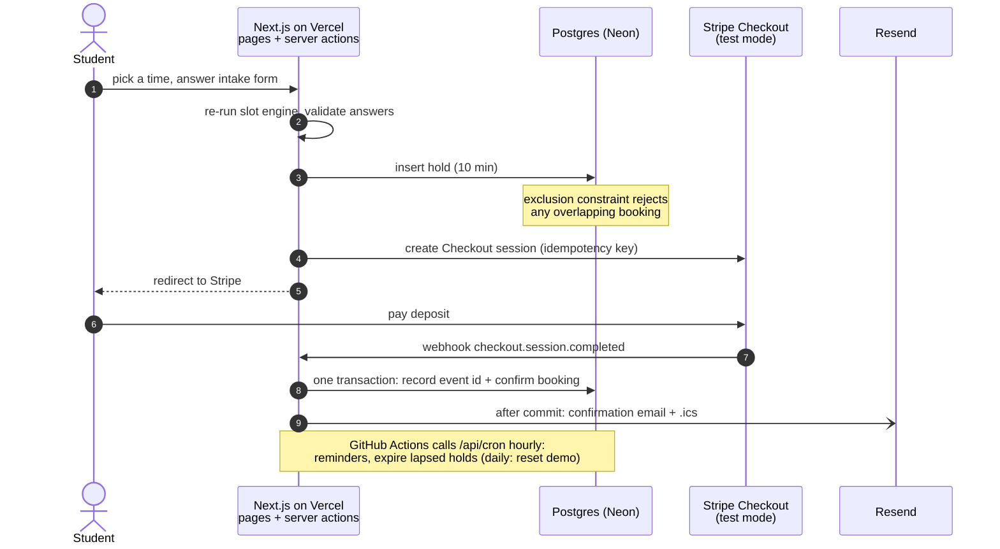

# Slotwise

Booking and deposits for solo tutors. A tutor shares one link. Students pick a time shown in their own time zone, pay a deposit, and get a confirmation. That means no back-and-forth, and fewer no-shows.

**Live:** https://slotwise-booking-xi.vercel.app. Click **Try the demo**, or book as a student at [/book/demo-tutor](https://slotwise-booking-xi.vercel.app/book/demo-tutor) (Stripe test mode: card `4242 4242 4242 4242`). Decisions and daily notes: [PROGRESS.md](./PROGRESS.md).

**Walkthrough video (90 s, narrated):** https://videos.bhupathi.dev/case-studies/slotwise.mp4



## Measured
Figures from production, with the raw data in [`docs/measurements`](docs/measurements).

| Page | Lighthouse mobile (Perf / A11y / Best practices / SEO) | Mobile LCP | Desktop |
|---|---|---|---|
| Home | 98 / 100 / 100 / 100 | 2.0 s | 100 on all four, LCP 0.5 s |
| Tutor page | 99 / 100 / 100 / 100 | 2.0 s | 100 on all four, LCP 0.5 s |
| Booking page (week timetable + intake questions) | 98 / 100 / 100 / 100 | 2.3 s | 100 on all four, LCP 0.3 s |

Median of 3 runs, Lighthouse 12.8.2 with default throttling, measured from India against the US region ([summary](docs/measurements/lighthouse-2026-10-14-timetable/SUMMARY.md)).

**Tests:** 156 Vitest tests (unit, plus database tests on PGlite) and 18 Playwright runs (9 tests on desktop Chrome and Pixel 7, against a production build and real Postgres), all green in CI.

## Features

| | Feature |
|---|---|
| ✅ | Passwordless sign-in (email magic link) and a one-click demo account |
| ✅ | Onboarding: booking-page handle and time zone |
| ✅ | Services: duration, price, deposit, buffer between bookings; archive instead of delete once booked |
| ✅ | Weekly hours (several ranges per day) and date changes (days off, custom hours) |
| ✅ | Double-booking prevention enforced by Postgres (see below) |
| ✅ | Booking page as a week timetable (one day at a time on phones), across time zones and daylight-saving changes, shown in the student's zone |
| ✅ | Intake questions built in [Formwise](https://github.com/krishnanbhupathi/formwise-builder): attach a published form to a service, answers validated on the server and shown to the tutor |
| ✅ | Stripe Checkout deposit (test mode), 10-minute hold, idempotent webhooks, auto-refund of late payments for taken slots |
| ✅ | Free services confirm instantly |
| ✅ | Confirmation email with `.ics`, 24-hour reminder, cancel/reschedule emails that update the calendar event |
| ✅ | Client cancel (deposit refunded until 24h before) and reschedule (deposit carries over) |
| ✅ | Provider dashboard: upcoming bookings (cancel with refund) and payments |
| ✅ | Demo account reset nightly, with sample bookings |

## Design
The look is a **school timetable**, the week grid students already know.
- **Booking page:** days across, times down. Each open time is a block in the subject's colour; closed days are hatched. On phones it becomes one day at a time.
- **One colour per subject:** each service gets a colour in the order the tutor created it ([`src/lib/subjects.ts`](./src/lib/subjects.ts)). The colour follows the lesson everywhere: tutor page, booking slip, confirmation, dashboard.
- **Type:** Gabarito for headings, times and prices; Lexend for text. Atkinson Hyperlegible was the first choice, but its slashed zero made prices read like "$1θ.θθ".
- The neutrals replace Tailwind's `stone` scale in [`globals.css`](./src/app/globals.css), so every screen shares one palette.

## Stack

Next.js 16 (App Router, Server Actions) · TypeScript · Postgres (Neon) with Drizzle ORM · Auth.js v5 · Stripe Checkout · Resend · Tailwind CSS · Vitest + PGlite · Vercel.

## Architecture



One Next.js app on Vercel serves the booking pages, the tutor dashboard (Auth.js), the Stripe webhook and the cron endpoints, all against one Postgres database. A booking is a **held** row first, and Postgres has the last word on overlaps. The webhook confirms it in the same transaction that records the event id, and email goes out only after that commit. The intake form is a copy the tutor pulls from Formwise's public API, so booking never calls Formwise.

## Run it locally

You need Node 20.9+ and a Postgres database (a free Neon project or a local Postgres).

```bash
npm install
cp .env.example .env.local        # set DATABASE_URL and AUTH_SECRET (npx auth secret)
npm run db:migrate && npm run db:seed && npm run dev
```

Open http://localhost:3000 and click **Try the demo**, or book a session at http://localhost:3000/book/demo-tutor. Without a `RESEND_API_KEY`, sign-in links are printed to the terminal rather than emailed.

To take test payments locally, add Stripe **test-mode** keys to `.env.local`, then forward webhooks with the Stripe CLI:

```bash
stripe listen --forward-to localhost:3000/api/stripe/webhook   # prints the STRIPE_WEBHOOK_SECRET to use
```

Pay with card `4242 4242 4242 4242`, any future expiry, any CVC.

```bash
npm test            # unit + database tests (no database server needed)
npm run test:e2e    # Playwright, desktop + mobile, against a production build (needs a local Postgres DB "slotwise_e2e")
npm run typecheck
npm run lint
```

## Design decisions

**The database prevents double-booking.** A GiST exclusion constraint rejects any two live bookings for the same provider whose `[starts_at, blocks_until)` ranges overlap. It covers held and confirmed bookings, and `blocks_until` includes the service's buffer. If two students race for the same slot, the second insert fails inside Postgres, whatever the application code does. The constraint is in [`drizzle/0001_no_double_booking.sql`](./drizzle/0001_no_double_booking.sql) and tested in [`src/db/constraints.test.ts`](./src/db/constraints.test.ts). *Trade-off:* it needs the `btree_gist` extension and a hand-written migration, because Drizzle can't express `EXCLUDE`.

**Tests run on real Postgres, with no database server.** Database tests use [PGlite](https://pglite.dev), Postgres compiled to WebAssembly and running in-process. They exercise the real constraints, checks and foreign keys, and CI needs nothing but Node. *Trade-off:* PGlite is Postgres 17 in a single connection, so it can't test behaviour that needs concurrent connections.

**Slots are a wall-clock grid, computed with Temporal.** Hours are stored as local wall-clock times in the tutor's zone, and bookings as UTC instants. The slot engine ([`src/lib/slots.ts`](./src/lib/slots.ts)) puts start times every 30 minutes on the local clock. A time skipped when clocks go forward isn't offered. A time that happens twice when clocks go back is offered once, at its first occurrence. Session length is real elapsed time. Tests pin this down for London's March and October changes, New York, Kolkata (no DST) and Kathmandu (UTC+5:45). *Trade-off:* the Temporal polyfill adds about 20 kB, but it only runs on the server.

**A hold is checked twice, and the database has the last word.** Booking re-runs the slot engine for the requested time. Then, in one transaction, it retires lapsed holds and inserts the new one. If two students race past the check, the exclusion constraint rejects the second insert, and they see "someone booked that time a moment ago". A test fires two concurrent requests to prove it.

**Webhooks are idempotent by event id.** Each Stripe event id is inserted into `stripe_events` in the same transaction as the event's effects. A redelivered event finds its id and does nothing. A failure rolls back both, so Stripe's retry starts clean. Checkout and refund calls also carry per-booking idempotency keys.

**Late payments.** Stripe Checkout sessions last at least 30 minutes, but a hold lasts 10. A payment that arrives after its hold lapsed confirms only if the slot is still free; a database savepoint lets the exclusion constraint decide. Otherwise the deposit is refunded automatically.

**Emails go out after the commit.** A failed email never undoes a booking. Emails are sent through `after()` once the database change has committed, and failures are logged. *Trade-off:* a failed email isn't retried; a durable outbox table is the next step. The `.ics` attachment keeps one UID per booking and increments `SEQUENCE` on each change, so a reschedule or cancellation updates the event already in the client's calendar.

**Reminders can't double-send.** An hourly job claims due reminders with a single `UPDATE … SET sent_at = now() … RETURNING`. Two overlapping runs can't claim the same row, and a failed send is un-claimed so the next run retries it. The job is triggered from GitHub Actions ([`.github/workflows/cron.yml`](./.github/workflows/cron.yml)), because Vercel's free plan runs crons at most once a day.

**The 24-hour rule lives in one place.** [`src/lib/policy.ts`](./src/lib/policy.ts) decides whether a client cancellation refunds the deposit and whether rescheduling is offered. The booking page, the server actions and the emails all read it.

**Money is integer cents.** Prices are parsed from strings straight into cents (`"45.50"` → `4550`), so the code never does floating-point arithmetic on money.

**Sessions are signed JWT cookies.** Auth.js's credentials provider, which powers the demo button, requires them, and they save a database read per request. *Trade-off:* a session can't be revoked server-side before it expires.

**Writes are scoped by owner.** Every update and delete filters on `provider_id` as well as the row `id`, so a forged id can't touch another provider's data. Tests cover this.

**Intake forms are copies, validated twice.** A tutor pastes a Formwise share link. The server fetches the published form only from the Formwise origin (`FORMWISE_ORIGIN`), validates it with Formwise's own `parseFormSchema`, and stores a copy on the service. Students answer with Formwise's `<FormFields>` inside Slotwise's booking form, and the server action re-validates the answers before creating any hold or Stripe session. The renderer is vendored in `src/vendor/formwise` by a sync script that records the source commit. *Trade-off:* changes published in Formwise appear only after the tutor clicks Refresh, but bookings never depend on Formwise being up.

**The timetable is built by a pure function.** [`src/lib/timetable.ts`](./src/lib/timetable.ts) turns slot starts into Monday-first weeks in the viewer's zone, so the same grid renders on server and client, and tests pin the edge cases (week boundaries, a slot that falls on the next day in Kolkata). *Trade-off:* each service has its own timetable; a combined week across subjects would need a new page and loading every service's slots.

**Deposits go to one platform Stripe account (no Connect).** This keeps v1 small. The `providers.stripe_account` column is reserved for moving to Stripe Connect later.

## Data model

| Table | Purpose |
|---|---|
| `providers` | Tutor profile: handle, name, IANA time zone |
| `services` | Name, duration, price and deposit (cents), buffer, active flag |
| `availability_rules` | Weekly hours: ISO weekday + start/end wall-clock time in the provider's zone |
| `date_overrides` | One per date: closed, or custom hours replacing the weekly rule |
| `bookings` | Client details and note, `starts_at`/`ends_at`/`blocks_until`, status (`held`, `confirmed`, `cancelled`, `refunded`, `expired`), hold expiry, `.ics` sequence, who cancelled and when |
| `payments` | Stripe Checkout session, amount, status |
| `reminders` | When to send, when sent |
| `stripe_events` | Ids of processed Stripe webhook events (idempotency) |
| `users`, `accounts`, `verification_tokens` | Auth.js |

## Deploying

Vercel runs `npm run db:migrate && npm run build` (see `vercel.json`). Set the variables from `.env.example` in the Vercel project. Use Neon's **pooled** connection string for `DATABASE_URL`. In the Stripe dashboard (test mode), add a webhook endpoint at `https://<your-domain>/api/stripe/webhook` for `checkout.session.completed`, `checkout.session.async_payment_succeeded` and `checkout.session.expired`, and put its signing secret in `STRIPE_WEBHOOK_SECRET`.

Scheduled jobs: set a random `CRON_SECRET` on Vercel, and add GitHub repository secrets `APP_URL` (the production URL) and `CRON_SECRET` (same value). The workflow skips quietly until both are set.

## Known limitations
- Taken times aren't shown on the timetable; the server only sends open times, so a taken slot simply isn't there.
- A failed email isn't retried (no outbox table yet).
- Emails come from a new sending domain (`mail.bhupathi.dev`, DKIM and SPF set up), so Gmail may file the first sign-in link in Spam until the domain builds a reputation. **Try the demo** doesn't need email.
- Intake conditions only support "equals one value" (a Formwise limitation).
- Sessions can't be revoked server-side before they expire (JWT cookies).

## License

[MIT](./LICENSE)
